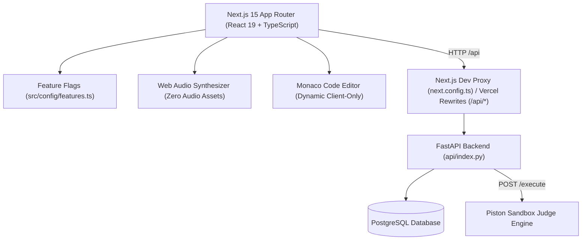

# ⚡ ZAP — Interactive Online Coding & DSA Mastery Platform

> **Learn algorithms by playing with state, not memorizing text.**  
> ZAP combines interactive step-by-step visualizers, TikTok-style **AlgoReels**, 4-beat concept stories, real-time competitive contests, and a live debugging arena.

[](https://react.dev/)
[](https://www.typescriptlang.org/)
[](https://nextjs.org/)
[](https://fastapi.tiangolo.com/)
[](https://tailwindcss.com/)

---

## 🚀 Why ZAP?

Traditional DSA courses and AI chatbots suffer from the same flaw: **passive walls of text**. Students skim explanations, copy AI answers, and suffer from the "illusion of competence" until an interviewer asks them to manipulate pointers on a whiteboard.

ZAP replaces passive reading with **tinker-first active simulation**:
1. **Interactive Visualizers**: Directly manipulate pointers, shrink/expand sliding windows, and watch state update in real-time.
2. **AlgoReels**: Vertical, swipeable micro-learning reels with interactive trivia challenges and zero-asset synthesized 8-bit Web Audio feedback.
3. **4-Beat Concept Stories**: Hook → Naive Trap → 'Aha!' Epiphany → Boilerplate Formula narrative cards.
4. **CodeWar Arena & Contests**: Real-time coding workspace with Monaco Editor, multi-language support (Python, C++, Java, C), automated test execution, and anti-cheat fullscreen enforcement.
5. **Safe Canary Releases**: Centralized, typed feature flag system (`src/config/features.ts`) for continuous deployment.

---

## 🛠️ Architecture & Tech Stack



- **Frontend**: Next.js 15 App Router, React 19, TypeScript, Tailwind CSS, Lucide React, Sonner toasts, Monaco Editor (dynamic client-side).
- **Micro-Interactions**: Zero-dependency Web Audio API sound synthesizer (`src/lib/soundEffects.ts`), Portal rendering (`createPortal` with client-mounted check) for full-bleed mobile reels.
- **Backend**: FastAPI, SQLAlchemy, PostgreSQL, Python 3.11+.
- **Execution Engine**: Sandboxed remote code runner powered by Piston.

---

## 🏁 Quickstart

### Prerequisites
- Node.js 18+ & `pnpm` (or `npm`)
- Python 3.11+ & virtual environment

### 1. Frontend Setup
```bash
# Install dependencies
pnpm install

# Start Next.js dev server on port 5173
pnpm run dev --port 5173
```

### 2. Backend Setup
```bash
cd api
python3 -m venv .venv
source .venv/bin/activate
pip install -r requirements.txt

# Start FastAPI dev server on port 8000
uvicorn index:app --reload --port 8000
```

---

## 🎛️ Feature Flags

ZAP features are controlled via [`src/config/features.ts`](src/config/features.ts) and can be toggled per-environment using `NEXT_PUBLIC_*` variables:

| Flag | Env Variable | Default | Description |
|---|---|---|---|
| `reels.showLikeButton` | `NEXT_PUBLIC_FEATURE_REELS_LIKE` | `false` | Like counter & heart reaction on reels |
| `reels.showSolveButton` | `NEXT_PUBLIC_FEATURE_REELS_SOLVE` | `false` | Deep-link button to open problem solver |
| `reels.showGuideButton` | `NEXT_PUBLIC_FEATURE_REELS_GUIDE` | `false` | Deep-link button to open full curriculum guide |
| `conceptStory.showDeck` | `NEXT_PUBLIC_FEATURE_CONCEPT_STORY` | `false` | 4-Beat Concept Story Deck on guide pages |

---

## 📂 Key Directory Map

```text
zap/
├── api/                   # FastAPI backend application
│   ├── index.py           # App entrypoint & CORS config
│   └── routers/           # Auth, contests, problems, execution
├── docs/                  # Architectural & pedagogical documentation
│   ├── INTERACTIVE_PEDAGOGY.md # Pedagogy & 4-card story methodology
│   └── dev-to-blog.md     # Official release article (Dev.to format)
├── next.config.ts         # Next.js configuration & /api proxy rewrites
├── src/
│   ├── app/               # Next.js 15 App Router routes & layouts
│   ├── views/             # Page view components (contests, guides, admin)
│   ├── components/
│   │   ├── guide/         # ConceptStoryDeck, algorithm visualizers
│   │   └── reels/         # AlgoReelsPlayer, AlgoReelsTray
│   ├── config/
│   │   └── features.ts    # Centralized feature flag manager (NEXT_PUBLIC_*)
│   ├── data/
│   │   ├── algoReels.ts   # Curated DSA micro-reels content & trivia
│   │   └── conceptStories.ts # 4-beat narrative cards
│   ├── hooks/
│   │   └── useGuideLogic.ts # Guide focus mode & keyboard shortcuts
│   ├── lib/
│   │   └── soundEffects.ts # 8-bit Web Audio synthesizer
│   └── types/             # Type definitions & next-stubs.d.ts
```

---

## 🧪 Quality Checks & Testing

Always verify before committing:
```bash
# TypeScript strict typechecking
pnpm tsc --noEmit

# Production build test
pnpm build
```

