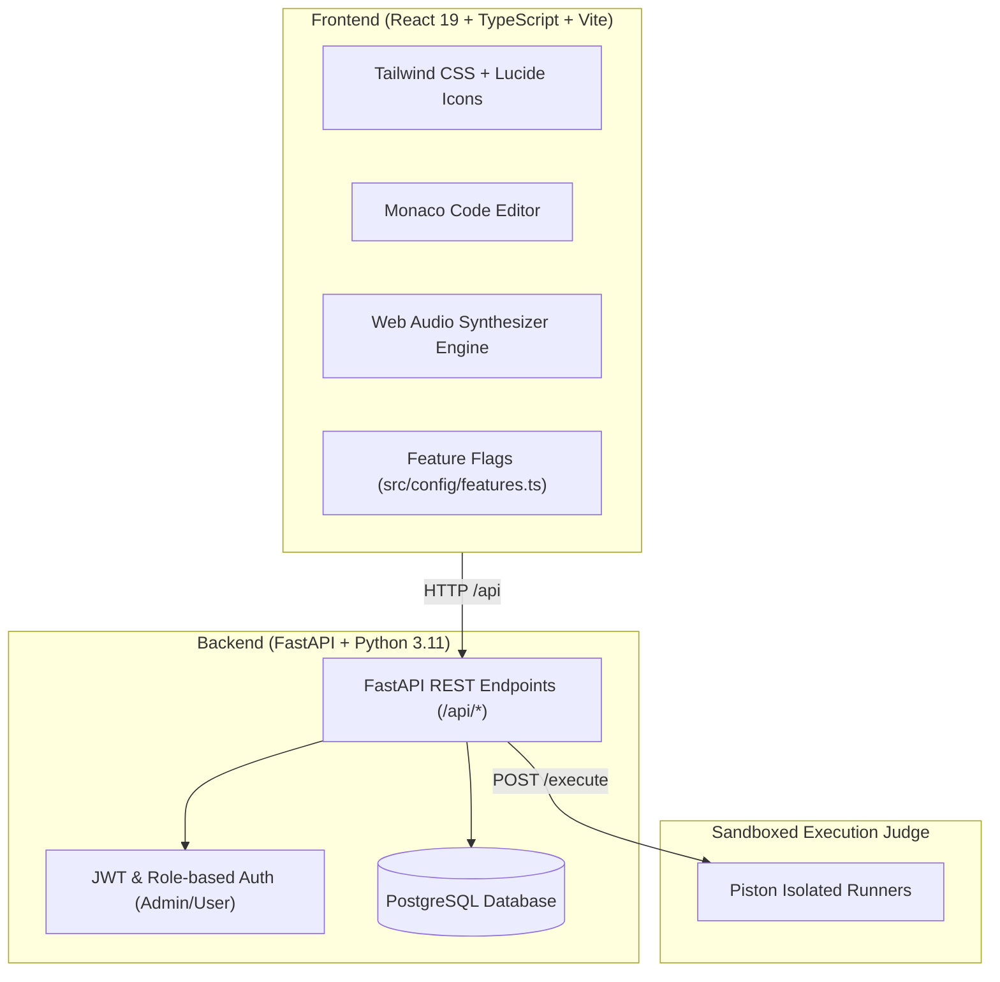

Let’s be honest: **the standard way of mastering Data Structures & Algorithms is broken.**

On one side, you have traditional competitive programming websites. You are greeted with a wall of dense text, arbitrary ASCII diagrams, and a dry code runner. If you struggle, you jump to ChatGPT or Claude. The AI immediately vomits the optimal 40-line solution with five bullet points. You skim it, nod along, think _"Yeah, that makes sense,"_ and click submit.

Two days later in an interview when asked to solve the exact same problem on a whiteboard, **your mind goes completely blank.**

That is the **Illusion of Competence**. Reading static explanations and copying AI output creates zero cognitive retention. Algorithms are dynamic state machines that evolve over time and space — you cannot internalize them by reading walls of text.

We wanted something better. A platform that combines the adrenaline of real-time competitive contests, the tactile intuition of interactive algorithm visualizers, the dopamine of TikTok-style micro-learning, and the rigor of real-world debugging battles.

That platform is **[codezap.in](https://codezap.in)**.

Here is the complete tour of what we engineered, every feature that powers the site, and the architectural decisions behind it.

---

## 🏛️ The Vision: A Complete Coding & DSA Ecosystem

[codezap.in](https://codezap.in) was engineered not just as another problem bank, but as an end-to-end active pedagogy ecosystem. The platform brings together five interconnected pillars:

```
┌────────────────────────────────────────────────────────────────────────┐
│                               codezap.in                               │
├───────────────────┬───────────────────┬────────────────────────────────┤
│ 🏆 CONTEST ARENA  │ 🎯 CODEWAR        │ 💡 INTERACTIVE GUIDES          │
│ • Monaco IDE      │ • Live Debugging  │ • Step-by-Step State Scrubbers │
│ • 4 Languages     │ • Timed Bug Hunt  │ • Focus Mode Navigation        │
│ • Hidden Testcases│ • Trace Analysis  │ • Sliding Window, Trees, Graphs│
├───────────────────┴───────────────────┴────────────────────────────────┤
│ 📱 ALGOREELS & 4-BEAT STORIES         │ 📊 ADMIN & ANALYTICS           │
│ • Vertical Swipe Micro-Learning       │ • Problem Bank CRUD & Importer │
│ • 8-Bit Web Audio Synthesizer         │ • Execution Audit Logs         │
│ • Pattern Cheatsheets & Trivia        │ • Contest Result CSV Exports   │
└───────────────────────────────────────┴────────────────────────────────┘
```

Let's dive into each feature.

---

## 1. 🏆 The Contest Workspace: Full-Featured IDE & Automated Judge

At the heart of [codezap.in](https://codezap.in) is our high-performance competitive programming environment designed for serious contest prep and university/company hackathons.

### Key Capabilities:

- **Production-Grade Monaco Editor**: Embedded VS Code editing experience with bracket matching, syntax highlighting, autocompletion, customizable themes, and keyboard shortcuts.
- **Multi-Language Execution Engine**: Native support for **Python 3, C++, Java, and C**. Every language comes pre-configured with starter boilerplates and automatic standard I/O piping.
- **Dual-Tier Test Suite Evaluation**:
  - _Public Sample Test Cases_: Immediate feedback with expected vs. actual output diffs and execution runtime stats.
  - _Hidden Benchmark Test Cases_: Anti-cheat evaluation with granular scoring, memory limits, and strict execution timeouts.
- **Custom Input Sandbox**: Run arbitrary test vectors on the fly before making an official submission.
- **Anti-Cheat Fullscreen Enforcement**: Automatic fullscreen lock on contest launch with detection warnings for window blur and tab switching.
- **Live Leaderboard & Penalty Calculations**: Real-time scoreboard with submission timestamps, problem-by-problem breakdowns, and automated late-submission tagging.

---

## 2. ⚡ CodeWar: The Live Debugging Battleground

In the real world, software engineers spend 80% of their time reading and debugging code, not writing it from scratch.

**CodeWar** is our timed debugging arena:

- **The Concept**: Instead of a blank canvas, you are thrown into broken code simulating real production bugs (off-by-one errors, edge-case memory leaks, race conditions, and inverted boundary checks).
- **The Objective**: Diagnose the defect using execution traces and test feedback, patch the flaw, and pass all regression suites before the clock hits zero.
- **Why It Works**: Debugging lowers the intimidating barrier of the "blank page" while cultivating deeper diagnostic intuition than simple problem memorization.

---

## 3. 🧩 Interactive DSA Visualizer Guides: Learn by Moving State

Most tutorials describe pointers with text: _"Increment left while shrinking the window."_ What does that actually look like in memory?

Our curriculum guides (covering **Sliding Window, Two Pointers, Graphs, Trees, Hashing, Queue/Stack, and System Design**) provide **interactive state machines**:

### What Makes Them Unique:

- **Direct Pointer Scrubbing**: Drag pointers, toggle window boundaries, and watch array indices, frequency maps, and recursion stacks recalculate dynamically.
- **Distraction-Free Focus Mode**: Powered by our custom `useGuideLogic.ts` engine. Rather than overwhelming you with endless scrolling, each problem renders in a dedicated focus card with keyboard shortcuts (`←` / `→`) and auto-synced navigation progress (`1 / 8`).
- **Brute Force vs. Optimal Contrasts**: Compare the naive $O(N^2)$ nested loop against the optimal $O(N)$ approach side-by-side to understand _why_ the optimal pattern is necessary.

---

## 4. 📱 AlgoReels: TikTok-Style DSA for Modern Attention Spans

Modern developers consume content on their phones in short bursts. Rather than fighting short attention spans, **AlgoReels** turns bite-sized browsing into a superpower.

Available directly on the [codezap.in](https://codezap.in) homepage tray:

- **60-to-90-Second Micro-Bites**: Curated reels covering pattern recognition ("When you see _Top K Frequent_, think _Min-Heap_"), time/space complexity traps, and algorithm trade-offs.
- **Zero-Asset 8-Bit Web Audio Synthesizer**: We built a pure code synthesizer using the browser's native `AudioContext` (`src/lib/soundEffects.ts`). No heavy `.mp3` downloads — sounds for swipes, correct answers, errors, and celebratory fanfares are generated through mathematical wave frequencies in real time.
- **Mobile-First Gestures & Portals**: Built with vertical swipe physics (`onTouchStart`, `onTouchMove`, `onTouchEnd`), dynamic viewport heights (`100dvh`), and React `createPortal` rendering so the reels look and feel like a native mobile app on any iPhone or Android screen.
- **Interactive Trivia Challenges**: Every reel challenges you with a multiple-choice question. Tap an option to receive immediate auditory and visual feedback.

---

## 5. 📖 4-Beat Concept Stories: Mental Models That Stick

Why do engineers remember production outages better than sorting algorithms? Because outages follow a **narrative arc**.

We codified this into our **4-Beat Concept Story Decks**:

1. **The Catastrophe**: A real-world engineering failure (e.g., live streaming server crashes under packet overflow).
2. **The Naive Trap**: The instinctive attempt that seems reasonable but melts down under scale ($O(N^2)$ timeout).
3. **The Epiphany**: The geometric or spatial trick that makes the problem simple.
4. **The Blueprint**: A clean, 10-line reusable boilerplate formula.

---

## 6. 🛠️ Robust Admin & Contest Operations Suite

For mentors, educators, and contest organizers, [codezap.in](https://codezap.in) includes an administrative backoffice:

- **Problem Bank CRUD**: Rich problem statement editor, difficulty tagging, starter boilerplates, and test case configuration with points/marks allocation.
- **Bulk Import/Export**: One-click import and export of problem suites in standardized JSON and Markdown formats.
- **Contest Scheduling & Lifecycle**: Draft, publish, schedule, or cancel contests with automated start/end triggers.
- **Audit Logs & Submission Inspector**: Full execution audit trail tracking memory usage, CPU execution time, and raw compiler outputs.
- **CSV/Excel Export**: Download complete leaderboard standings and participant metrics for grading or hiring analysis.

---

## ⚙️ Under The Hood: The Architecture of codezap.in



### Key Technical Highlights:

1. **React 19 & TypeScript Strict Mode**: Built with `strict`, `noUnusedLocals`, and `noUnusedParameters` enabled to ensure rock-solid stability.
2. **FastAPI & PostgreSQL**: Clean REST architecture with automated migrations, Pydantic data serialization, and transactional integrity.
3. **Piston Sandboxing**: Untrusted user code is executed in isolated, ephemeral sandboxes with strict CPU, memory, and networking limits.
4. **Centralized Feature Flags (`src/config/features.ts`)**: Every experimental capability (like AlgoReels action buttons and concept story decks) is gated through environment-driven feature toggles (`VITE_*`), allowing seamless canary testing without downtime.
5. **Universal Light & Dark Mode**: Tailored CSS tokens and semantic palette matching ensuring high contrast and zero eye strain in both light and dark environments.

---

## 🚀 The Takeaway: Learn by Doing

The era of passively reading algorithm textbooks and mindlessly memorizing LeetCode solutions is over. To truly master problem solving, you need to see the state move, feel the complexity trade-offs, and test yourself under real-time pressure.

Everything you need — from 60-second AlgoReels and interactive visualizer guides to full-blown coding contests and debugging wars — is live right now.

👉 **Experience the platform today at [codezap.in](https://codezap.in)**

_Are you preparing for technical interviews or organizing coding contests? Check out [codezap.in](https://codezap.in) and let us know what features or visualizers you'd like to see next in the comments below!_
