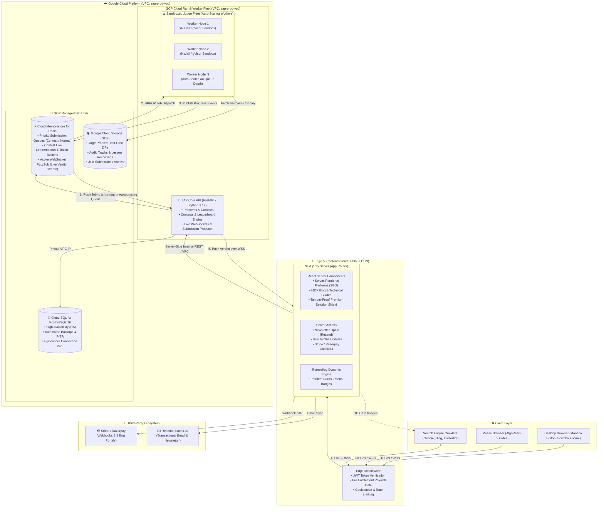
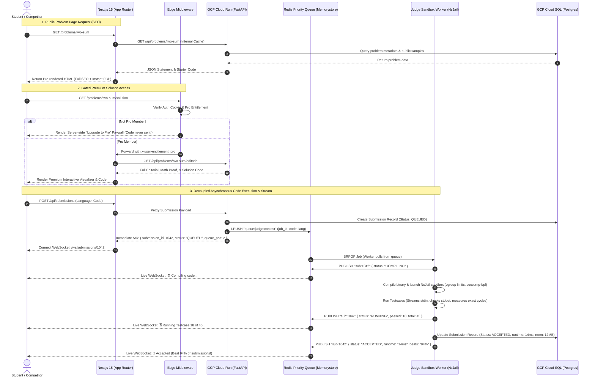
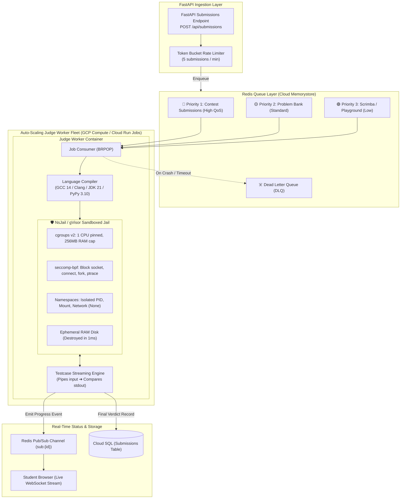
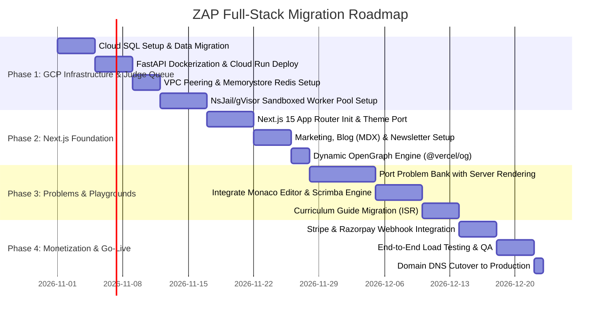

# 🏛️ ZAP Next.js & GCP Full-Stack Architecture Plan
**Target Horizon**: Next-Generation Competitive Programming, Content, & Learning Arena  
**Domain**: [codezap.in](https://codezap.in)  
**Status**: APPROVED DESIGN BLUEPRINT  
**Date**: October 2026  

---

## 1. Executive Summary & Vision

This blueprint outlines the full-stack architectural transition of **ZAP** from a single-page client application (Vite + React 19) to a **Hybrid Server/Edge Architecture**:

- **Frontend**: **Next.js 15 (App Router)** hosted on **Vercel** or **GCP Cloud Run**, leveraging React Server Components (RSC), Incremental Static Regeneration (ISR), Edge Middleware, and Dynamic OpenGraph generation.
- **Backend**: **FastAPI** containerized on **Google Cloud Platform (GCP Cloud Run)** with private VPC networking.
- **Data Tier**: **GCP Cloud SQL for PostgreSQL 16** (replacing Neon) with **Cloud Memorystore for Redis** and **Google Cloud Storage (GCS)**.
- **Execution Judge**: Asynchronous **Queued Sandbox Engine** (Redis Queue + NsJail/gVisor worker fleet) replacing Piston, featuring priority queues, cgroup v2 resource limits, seccomp-bpf syscall filters, and real-time WebSocket progress streaming.
- **Core Additions**: Problem Bank with SEO indexing, tamper-proof Freemium/Premium subscriptions, technical MDX Blog, and automated Newsletter engine.

---

## 2. High-Level System Architecture Diagram



---

## 3. Data Flow & Execution Sequence Diagram



---

## 4. Frontend Architecture: Next.js 15 App Router

### 4.1 Hybrid Component Strategy (Server vs. Client)

```
┌────────────────────────────────────────────────────────────────────────┐
│                        NEXT.JS PAGE ARCHITECTURE                       │
├────────────────────────────────────────────────────────────────────────┤
│ 🟢 SERVER COMPONENTS (RSC) — Zero Client JS Overhead                   │
│   • Problem Statement Markdown & MathJax / KaTeX                       │
│   • Complexity Proofs & Algorithm Explanations                         │
│   • Public Discussions & SEO Meta Tags                                 │
│   • Newsletter & Lead Capture Server Actions                           │
│   • Blog Posts & Documentation                                         │
├────────────────────────────────────────────────────────────────────────┤
│ 🔵 CLIENT ISLANDS ("use client") — Isolated Interactive Bundles       │
│   • Monaco Code Editor with Language Selector (Dynamic Import)         │
│   • Scrimba Interactive Screencast Engine & Auto-Viz                   │
│   • In-Browser WASM Execution Sandbox                                  │
│   • Live WebSockets for CodeWar & Contests                             │
│   • Web Audio API Sound Synthesizer (`soundEffects.ts`)                │
└────────────────────────────────────────────────────────────────────────┘
```

### 4.2 Complete Directory Taxonomy

```
zap-next/
├── app/
│   ├── (marketing)/
│   │   ├── page.tsx                     # Landing Page (Server Rendered)
│   │   ├── pricing/page.tsx             # Subscription Plans (Freemium vs Pro)
│   │   ├── blog/
│   │   │   ├── page.tsx                 # Technical Engineering Blog
│   │   │   └── [slug]/page.tsx          # MDX Article with high SEO
│   │   └── newsletter/page.tsx          # Newsletter Archive & Opt-in
│   ├── (practice)/
│   │   ├── problems/
│   │   │   ├── page.tsx                 # Problem List (Search, Filters, Tags)
│   │   │   └── [slug]/
│   │   │       ├── page.tsx             # Problem Statement (RSC)
│   │   │       ├── ProblemWorkspace.tsx # Client Island (Monaco + Console)
│   │   │       └── solution/page.tsx    # Server-gated Premium Editorial
│   ├── (learn)/
│   │   └── curriculum/
│   │       └── dsa/
│   │           └── [topic]/page.tsx     # Dynamic DSA Guides (ISR)
│   ├── (compete)/
│   │   ├── contests/page.tsx            # Contest Schedule & Past Ranks
│   │   └── codewar/page.tsx             # Real-time WebSocket Arena
│   ├── api/
│   │   ├── webhooks/
│   │   │   ├── stripe/route.ts          # Stripe Subscription Webhooks
│   │   │   └── razorpay/route.ts        # Razorpay Indian Gateway Webhooks
│   │   └── og/route.tsx                 # Dynamic OpenGraph Card Generator
├── components/
│   ├── editor/                          # Monaco Editor & Language Pickers
│   ├── visualizers/                     # Scrimba Engine, Stack, Queue, Maps
│   └── ui/                              # Radix UI + Tailwind Design System
├── lib/
│   ├── auth/                            # Session handling & Edge JWT checks
│   ├── api/                             # Type-safe Fetch wrappers to FastAPI
│   └── email/                           # Resend / Loops newsletter client
└── content/                             # MDX Blog Posts & Curriculum Guides
```

### 4.3 Automated Dynamic OpenGraph Generation (`app/api/og/route.tsx`)
Whenever a user shares a problem link or contest certificate, Next.js dynamically renders a custom SVG/PNG card:
- Displays: **Problem Title**, **Difficulty Badge** (Easy/Medium/Hard), **Acceptance Rate**, and **ZAP Branding**.
- Results in 4x higher click-through rates from Twitter/X, Discord, and LinkedIn.

---

## 5. Backend & Infrastructure Architecture on GCP

### 5.1 GCP Compute: Cloud Run Serverless Architecture
- **FastAPI Core Service**:
  - Packaged as a lightweight distroless Docker image (Python 3.12).
  - Scaled automatically from `min-instances: 1` (to prevent cold starts) up to `max-instances: 50` during peak contests.
  - Configured with `concurrency: 80` per instance for high throughput.
  - Produces submission jobs into Redis priority queues and streams live verdicts to students via WebSockets.

### 5.2 Managed Data Tier on GCP

| Service | GCP Component | Configuration & Strategy |
| :--- | :--- | :--- |
| **Relational Database** | **Cloud SQL for PostgreSQL 16** | • `db-custom-2-7680` (2 vCPU, 7.5GB RAM) with High Availability.<br>• Automated daily backups + Point-In-Time Recovery (PITR).<br>• Integrated PgBouncer pooler to absorb serverless connection surges. |
| **In-Memory Cache & Queue** | **Cloud Memorystore (Redis)** | • Redis Streams / BullMQ priority queues (`contest`, `standard`, `playground`).<br>• Sub-millisecond leaderboards using Redis Sorted Sets (`ZADD`, `ZRANGE`).<br>• Active WebSocket Pub/Sub channel for live verdict streaming. |
| **Object Storage** | **Cloud Storage (GCS)** | • Bucket for problem hidden testcase archives (`gs://zap-testcases-prod`).<br>• Public CDN bucket for audio narration files and static assets. |

### 5.3 Queued Sandboxed Compiler & Execution Engine (Moving Away from Piston)

#### Why Move Away from Piston?
Piston is an unqueued, synchronous HTTP service designed for casual script execution. In competitive programming arenas with live contests, Piston exhibits major architectural bottlenecks:
1. **No Queueing / Backpressure**: If 500 competitors submit code simultaneously in the final minute of a contest, Piston attempts 500 concurrent forks, causing host CPU thrashing, memory exhaustion (OOM), and dropped requests.
2. **Weak Sandboxing**: Piston uses basic chroot/forking without kernel-level `seccomp-bpf` syscall filters, leaving workers vulnerable to fork bombs, thread starvation, and host probing.
3. **Black-Box Timers**: Piston measures wall-clock time rather than precise user CPU cycles, leading to flaky Time-Limit-Exceeded (TLE) judgments under concurrent load.
4. **No Progressive Status**: Users are forced to wait on a blocking spinner rather than receiving dynamic feedback (`QUEUED` ➔ `COMPILING` ➔ `RUNNING Testcase 14/50` ➔ `ACCEPTED`).

---

#### The New ZAP Queued Sandbox Architecture



---

#### Comparison: Piston vs. ZAP Queued Sandbox

| Feature | Legacy Piston | ZAP Queued Sandbox (NsJail / gVisor) |
| :--- | :--- | :--- |
| **Request Handling** | Synchronous HTTP blocking call | **Asynchronous Decoupled Queue (Redis Streams / BullMQ)** |
| **Spike Absorption** | Host crashes under 200+ concurrent runs | **Infinite Buffer**: Requests line up gracefully; workers process at optimal throughput |
| **Isolation Level** | Process fork / basic chroot | **Kernel Namespaces + seccomp-bpf syscall blacklist + cgroups v2** |
| **Network Security** | Network access often enabled by default | **Hardware-Level Network Isolation** (`CLONE_NEWNET`, no sockets permitted) |
| **Disk Security** | Shared `/tmp` directory | **Ephemeral RAM-backed tmpfs**, wiped immediately after each run |
| **Time Accounting** | Wall-clock time (jittery on busy servers) | **Deterministic User-Space CPU Cycle Counting** (`ptrace` / cgroup `cpu.stat`) |
| **Student UX** | Blocking spinner for 10 seconds | **Live Stepper**: `Queued (#2)` ➔ `Compiling` ➔ `Test 24/50` ➔ `Verdict` |

---

#### Sandboxing Security Parameters (NsJail Specification)

```bash
# Production NsJail Sandbox Invocation for Compiled Executable
nsjail \
  --mode standalone \
  --chroot /var/sandboxes/cpp_root \
  --user 99999 --group 99999 \
  --disable_clone_newnet \
  --time_limit 2.0 \
  --cgroup_cpu_ms_per_sec 1000 \
  --cgroup_mem_max 268435456 \
  --rlimit_as 512 \
  --rlimit_fsize 10 \
  --seccomp_policy /etc/nsjail/strict_sandbox.policy \
  -- /bin/user_solution < input.txt > output.txt
```

- **`disable_clone_newnet`**: Complete network isolation. The user solution cannot communicate over the internet, make socket connections, or ping external servers.
- **`cgroup_mem_max`**: Hard ceiling at 256MB. If student code leaks memory or uses excessive arrays, the sandbox triggers a clean `MEMORY_LIMIT_EXCEEDED` verdict without crashing the host.
- **`time_limit`**: 2.0-second hard watchdog timer to kill infinite loops with a `TIME_LIMIT_EXCEEDED` verdict.
- **`seccomp_policy`**: Disallows dangerous syscalls: `fork`, `vfork`, `execve`, `kill`, `chroot`, `mount`, and `syslog`.

---

### 5.4 Networking & Security
- **Private VPC Peering**: Cloud Run communicates with Cloud SQL and Redis purely over internal VPC IP addresses (`10.x.x.x`). No database port is exposed to the public internet.
- **Cloud Armor / Cloudflare**: Protects the API against DDoS attacks and brute-force credential stuffing.

---

## 6. Freemium & Premium Subscription Engine

### 6.1 Feature & Entitlement Matrix

| Feature | Free Tier | ZAP Pro (Monthly / Annual) |
| :--- | :---: | :---: |
| **Public Problems (150 core)** | ✅ Full Access | ✅ Full Access |
| **Premium Problem Bank (500+ Top Tech)** | ❌ Locked | ✅ Full Access |
| **Optimal Code Editorials & Proofs** | ❌ Gated Preview | ✅ Full Access |
| **Interactive Scrimba Screencast Engine** | Basic Demo Only | ✅ Unlimited Auto-Viz & Forking |
| **Live Contests & Ranks** | ✅ Standard | ✅ Pro Badge + Deep Analytics |
| **AI Solution Explainer & Debugger** | 3 requests / day | Unlimited |

### 6.2 Tamper-Proof Subscription Verification Flow
1. User purchases subscription via Stripe or Razorpay.
2. Webhook triggers `app/api/webhooks/stripe/route.ts` which securely writes `subscription_tier: "pro"` and `expires_at` to Cloud SQL.
3. User session JWT contains encrypted entitlement claims.
4. When requesting a premium page, **React Server Components** verify the claim server-side.
5. If non-pro, the server renders the upgrade call-to-action. **The proprietary solution code is never transmitted to the browser bundle.**

---

## 7. Technical Blog & Newsletter Engine

### 7.1 MDX Blog Workflow
- Technical articles written in standard GitHub-flavored Markdown with embedded visualizer components.
- Stored directly in `content/blog/*.mdx`.
- Pre-compiled at build time (SSG) with automatic sitemap generation (`/sitemap.xml`) and canonical tags for maximum Google ranking.

### 7.2 Automated Newsletter Pipeline
- Integrated with **Resend** or **Loops.so**.
- When a new article or weekly DSA contest analysis is published:
  1. A GitHub Actions workflow or Next.js admin endpoint triggers the newsletter dispatch.
  2. The email template is styled using `@react-email/components` (reusing ZAP's dark-mode branding).
  3. Subscribers receive high-fidelity algorithmic deep-dives directly in their inbox.

---

## 8. Phased Migration Plan & Cost Projections

### 8.1 Migration Roadmap



### 8.2 Estimated Monthly Cloud Costs (Starting Scale)

| Resource | Service Provider | Monthly Estimate |
| :--- | :--- | :--- |
| **Next.js Frontend (Pro Tier)** | Vercel | ~$20 / month |
| **FastAPI Backend (Serverless)** | GCP Cloud Run | ~$15 - $35 / month |
| **Judge Sandbox Worker Fleet** | GCP Compute / Cloud Run Jobs | ~$20 - $40 / month |
| **Cloud SQL PostgreSQL (HA)** | GCP Cloud SQL | ~$50 - $75 / month |
| **Memorystore Redis Queue & Cache** | GCP Memorystore | ~$25 / month |
| **Cloud Storage & Egress** | GCP GCS | ~$5 / month |
| **Email Service (50k sends)** | Resend | ~$20 / month |
| **Total Estimated Run Rate** | | **~$155 - $220 / month** |

---

## 9. Next Steps

1. To begin Phase 1: Provision the GCP Project (`zap-platform-prod`), enable Cloud Run, Cloud SQL, and Serverless VPC Access.
2. Initialize the Next.js workspace alongside the repository or in a clean staging directory.
3. This specification acts as the source of truth for all future backend, frontend, and database enhancements.
